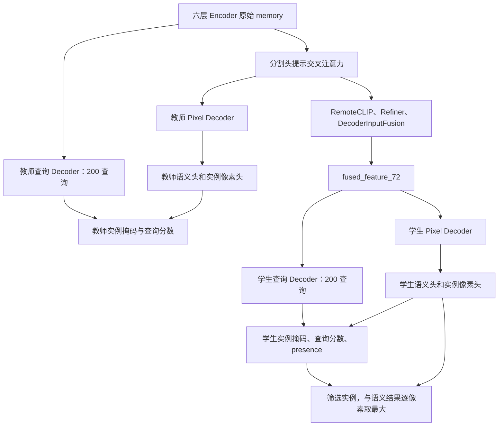

# OVRS-SAM3 设计说明

项目仓库：`jk-jin/ovrs-sam3`。任务仍是开放词汇遥感**语义分割**；实例分支是内部的候选预测与语义增强路径，`task_mode` 保持 `semantic`。

当前版本：双头学生前向、原始 SAM3 教师、全部 BCE 损失。语义掩码蒸馏、实例掩码蒸馏和查询匹配分数蒸馏**都只作用于 GT 存在的图像—类别对**。不使用 Dice、查询特征蒸馏、框蒸馏或 presence 蒸馏。

## 1. 模型目标与流程

SAM3 提供图像 FPN、文本编码、六层图文 encoder、六层查询 decoder 和预训练分割头。RemoteCLIP、全类别 Refiner 与 DecoderInputFusion 产生学生的融合特征。融合特征同时驱动查询分支与像素分支。



学生与教师共享同一套**冻结**的 SAM3 查询 decoder、评分头、Pixel Decoder、语义头、实例像素头与掩码 MLP。教师不是 EMA，也不复制可训练的学生分支。教师只在训练需要蒸馏、且当前图像—提示对存在时运行，推理完全不运行教师。

## 2. 特征与输出约定

| 名称 | 形状或含义 |
| --- | --- |
| `B` | batch 图像数 |
| `P` | 逗号拆分后的提示数；同类别别名共享 GT |
| `P_chunk` | 当前提示块数量，默认 1 |
| `Q` | 查询数量，固定 200；训练与推理均关闭 DAC 扩展 |
| `backbone_fpn` | 依次为图像级 288、144、72 特征，通道均为 256 |
| 原始 encoder memory | `[72*72, B*P_chunk, 256]`，六层 encoder 的输出，尚未经过额外提示注意力 |
| `cross_attended_encoder_features_72` | `[B,P,256,72,72]`，额外提示注意力后的缓存，也是 Refiner 的输入来源 |
| `fused_feature_72` | `[B*P_chunk,256,72,72]`，融合模块输出 |
| `instance_logits` | `[B,P_chunk,200,288,288]`，学生实例掩码原始分数 |
| `query_logits` | `[B,P_chunk,200]`，查询与文本匹配的原始分数，尚未乘 presence |
| `presence_logits` | `[B,P_chunk]`，查询 decoder 的 presence token 输出 |
| `instance_union_log_prob` | `[B,P_chunk,288,288]`，不筛选、按查询概率加权的实例聚合图的对数概率 |
| `fused_log_prob` | 同上形状，筛选实例后与语义图融合的对数概率 |

`decode_encoder_refiner_chunk_from_cache()` 的 `final_logits` 是供语义 GT/蒸馏使用的**语义头原始 logits**。`run_encoder_refiner_from_cache()` 对外返回的 `final_logits` 则是**最终融合概率对应的 logits**，adapter、评测、TTA 和可视化由此读取融合结果。

教师输出只包含当前 chunk 中存在的 pair：`teacher_pair_indices` 是按图像优先、提示其次顺序展平后的索引；对应 `teacher_semantic_logits` 为 `[N_present,288,288]`，`teacher_instance_logits` 为 `[N_present,200,288,288]`，`teacher_query_logits` 为 `[N_present,200]`。教师输出全部 detach，不用零填充去假装不存在类别也有教师预测。

## 3. SAM3 双头解码与缓存

### 3.1 缓存必须保留两个不同阶段的特征

`_encode_sam3_chunk()` 在 `no_grad()` 中执行六层 encoder，并保留 `memory`、`padding_mask`、`pos_embed`、`level_start_index`、`spatial_shapes`、`valid_ratios`、`prompt` 和 `prompt_mask`。这些张量按原提示 chunk 保存为 `query_chunks[(start,end)]`。

随后调用一次 `apply_prompt_cross_attention()`，生成已有的 `cross_attended_encoder_features_72`。不能用它冒充教师查询 decoder 的原始输入。

### 3.2 查询分支

恢复官方配置的六层 decoder、200 个查询、256 维 hidden、参考框逐层更新、`boxRPB="log"`、文本交叉注意力和 presence token。保持原始参数名称以加载完整 SAM3 checkpoint。`dac=False`，调用时还显式传 `apply_dac=False`，不产生 400 个训练查询。

教师读取原始 encoder memory；学生读取融合特征展平后的 memory。二者使用同一图像—提示对的位置编码、文本提示与空间元信息。查询 decoder 输出从 sequence-first 转为 batch-first 后，通过原始 DotProductScoring 产生匹配 logits。这里的“匹配”是查询和文本匹配，不是匈牙利配对。

Presence 来自查询 decoder 的 `presence_token_head`，不是 `UniversalSegmentationHead.presence_head`。后者仍关闭。评分头不提前合入 presence，防止后处理重复相乘。

### 3.3 像素分支

教师将已经经过额外提示交叉注意力的原始 encoder72 送入 Pixel Decoder；学生直接将 fused72 送入同一个 Pixel Decoder，**融合之后不再执行提示交叉注意力**。

每条路径分别只跑一次 Pixel Decoder，得到高分辨率像素特征：

- `semantic_seg_head` 产生单类别语义 logits；
- `instance_seg_head` 的 1×1 卷积产生实例像素特征；
- 每个最终查询经三层掩码 MLP，与实例像素特征逐通道点积，产生 200 张实例 logits。

Pixel Decoder 保持原始 nearest 插值、FPN144/FPN288 跳接和卷积；FPN 仍为 `[288,144,72]` 顺序。教师筛选 pair 时同步选择图像 id、文本、位置编码和有效比例，保持 batch/prompt 对齐。

## 4. RemoteCLIP 分支

### 4.1 Dense 图像编码

RemoteCLIP 使用 ViT-L/14。原始图像单独缩放到 504×504，并使用 CLIP mean/std 归一化，得到 36×36 patch grid。

前面的 transformer blocks 正常执行；最后一个 block 使用 dense value-branch：

1. 计算 QKV 投影；
2. 只取 V 分支；
3. 经过 attention output projection；
4. 向空间 token 注入 class token 信息；
5. 执行 MLP 残差；
6. 经过 `ln_post` 和原始 visual projection。

最终输出 `[B, 768, 36, 36]`。配置 `image_intermediate_layers=[7, 15]` 使用零基索引，
对应第 8、16 层；中间特征保留原生通道，ViT-L/14 为 1024，不能按最终投影的 768 通道处理。
第 8、16 层中间特征固定参与 score 类内注意力的 Q/K 指导。
训练且 RemoteCLIP 图像分支允许微调时，在提取与缓存处保留计算图；debug 输出仍 detach。
验证或冻结图像编码时不启用梯度。不额外运行 RemoteCLIP。

### 4.2 模板文本编码

每个类别使用 64 个固定遥感文本模板，生成 `[C, 64, 768]` 的模板特征。文本编码支持 micro-batch 和 non-reentrant activation checkpoint。

缓存规则必须服从参数是否可训练：

* RemoteCLIP 文本分支完全冻结时，可以缓存 detach 后的模板特征。
* 文本分支可训练且全局梯度开启时，每个训练 step 重新编码并保留计算图。
* 验证位于 `torch.no_grad()` 中，可以在一次验证过程中复用当前权重对应的缓存。

不能用模块的 `training` 属性判断是否需要梯度，因为 RemoteCLIP 在部分微调时仍保持 `eval()`。

### 4.3 Score embedding

64 个模板文本特征和 36×36 dense RemoteCLIP 图像特征分别做
L2 归一化，逐像素计算余弦相似度并乘固定系数 20，得到
[B, C, 64, 36, 36] 模板分数图。

模板分数图展平 batch 与类别维后，经过 64→256 的 1×1 Conv、
GroupNorm 和 GELU，得到中间特征 1。

中间特征 1 与 RemoteCLIP dense feature map 在每个空间位置分别沿
通道维执行 L2 归一化。归一化后的 256 通道中间特征与归一化后的
768 通道 CLIP 特征拼接，经 1024→256 的 1×1 Conv、GroupNorm 和
GELU 得到中间特征 2。

中间特征 1 与中间特征 2 再次分别执行逐像素通道 L2 归一化，
拼接为 512 通道。随后依次经过普通 3×3 Conv 512→256 和普通
3×3 Conv 256→256；每层卷积后均使用 GroupNorm 和 GELU。

最终输出 [B, C, 256, 36, 36] 的 clip_score_embed_36。该特征不再
接收 SAM3 FPN 注入，直接作为 Refiner 的初始 score stream。

## 5. Class-conditioned encoder refiner

Refiner 在 36×36 上同时维护图像 feature 流和 score embedding 流。默认使用 4 层、8 个 attention heads、12×12 窗口和 6 像素 shift。

### 5.1 Feature stream 与 score stream 初始化

Cross-attended full-encoder feature（72×72）双线性下采样到 36×36，得到
`base_feature_36`，直接作为 feature stream。

score_embeddings.py 生成的 clip_score_embed_36 直接作为 score
stream。进入所有 Refiner Attention 层之前不再融合任何 SAM3 FPN
特征，也不再设置额外残差系数。

SAM3 FPN72 用于后续单尺度 DecoderInputFusion 的细节支路，并固定下采样到 36×36，
为更新 feature 的类内注意力提供 Q/K 指导，仍不注入初始 score embedding。
FPN144 和 FPN288 由原始 Pixel Decoder 内部消费。

### 5.2 固定图像指导与标准 FFN

四层按 A→B→A→B 执行，每层始终先更新 score stream，再更新 feature stream，
最后执行 Feature FFN 和 Score FFN。各层注意力参数独立。
不保留四个可选指导开关，注意力不使用 CLIP 或 SAM3 文本 token 指导。
原始 CLIP 文本模板编码仍用于生成初始 score embedding。

| 层 | score 更新 | feature 更新 | 最后 |
| --- | --- | --- | --- |
| 1、3（A） | 类内注意力，固定 CLIP 中间层指导 | 类间注意力 | Feature FFN→Score FFN |
| 2、4（B） | 类间注意力 | 类内注意力，固定 FPN36 指导 | Feature FFN→Score FFN |

类内注意力分别对 score、feature 和图像指导做逐像素通道 LayerNorm，
Q/K 按 `[score_embed, feature, guidance]` 拼接后独立线性投影。
两种类间注意力都只拼接 `[score_embed, feature]`。
两路均为 256 通道时，类内 Q/K 输入为 768，类间为 512，投影后为 256 通道。
Value 始终仅来自指定的目标流，输出直接残差到同一条流。
后续子步骤使用已经更新的 score 或 feature，重新计算 pre-norm、Q/K/V 和注意力权重。

**固定图像指导：**

* score 类内：配置 `image_intermediate_layers=[7, 15]` 对应 CLIP 第 8、16 层原生特征。
  两层沿通道拼接，经一个共享 1×1 Conv 到 256 通道，每次 Refiner 前向只计算一次，
  再从图像维广播到全部类别提示。ViT-L/14 中间特征为 1024 通道，卷积输入为 2048。
* feature 类内：取冻结的 `backbone_fpn[2]`，从 72×72 双线性下采样到 36×36
  （align_corners=False），保留 256 通道，不增加通道投影，再广播到全部类别提示。
* 两种指导都是必需输入，缺失特征、原生通道错误或缺少中间层索引 7/15 时直接报错。

**类内空间实现继续可配置：**

| 配置 | 取值 | 含义 |
| --- | --- | --- |
| `score_intra_attn_type` | `window` / `local_3x3` | 更新 score 的类内实现 |
| `feature_intra_attn_type` | `window` / `local_3x3` | 更新 feature 的类内实现 |

默认均为 `window`，执行一次普通窗口与一次移位窗口，沿用窗口相对位置偏置和 shift mask。
`local_3x3` 执行四次连续普通逐像素 3×3 注意力：步长 1，无空洞或采样间隔，
含中心及八个相邻位置，每头九个独立相对位置偏置，图像外的 key 在 softmax 前屏蔽。
每个空间子步骤的投影、LayerNorm、相对位置偏置独立，图像指导在所有子步骤中固定使用。
四次局部子步骤属于一层内部，不增加 Refiner 总层数。

**标准双流 FFN：**

Feature FFN 和 Score FFN 分别处理各自当前注意力后的 256 通道特征。
每路执行通道 LayerNorm(256)、独立逐 token `256→1024→256` FFN（GELU 和 dropout），
输出直接残差到对应当前流。不拼接模块入口初始特征或本层入口特征。
全部层结束后仅对 feature_36 执行一次通道 LayerNorm；最终 score 不加输出 LayerNorm。
图像子层沿用 non-reentrant checkpoint，显式传入固定 CLIP 中间层和 FPN36 指导。

### 5.3 单尺度 Decoder Input Fusion

Refiner 在全部提示上统一执行后，最终 36×36 feature stream 先经过一次通道 LayerNorm，
再进入 `DecoderInputFusion`。融合只在 72×72 执行一次，输出 256 通道 72×72 特征，
替换原始 SAM3 Pixel Decoder 的最后一层 FPN 输入。

**输入**（`N = B×P_chunk`）：

- refiner_feature_36 `[N, 256, 36, 36]`
- original_encoder_feature_72 `[N, 256, 72, 72]`
- sam_fpn_72 `[B, 256, 72, 72]`

Refiner 特征先双线性插值到 72×72（`align_corners=False`）。这里使用缓存中的
`cross_attended_encoder_features_72` 作为原始 encoder72，它已经过完整 6 层 encoder 和一次
前置 prompt cross-attention，且未被 Refiner 更新。

四路独立的 256→128 投影（`1×1 Conv + GroupNorm`，无激活）：

```text
semantic_refiner_proj: refiner_72  [N, 256, 72, 72] → [N, 128, 72, 72]
detail_refiner_proj:   refiner_72  [N, 256, 72, 72] → [N, 128, 72, 72]
encoder_proj:          encoder_72  [N, 256, 72, 72] → [N, 128, 72, 72]
fpn_proj:              sam_fpn_72  [B, 256, 72, 72] → [B, 128, 72, 72]
```

语义和细节分支各自使用独立的 Refiner 投影（`semantic_refiner_proj` 和 `detail_refiner_proj`），参数不共享。

FPN 先按图像投影到 128 通道，再通过广播与 Refiner 逐提示相加。不使用 `repeat` 或 `repeat_interleave` 复制 256 通道 FPN。

两条独立支路（不能共享参数），结构相同：

```text
block: 普通 3×3 Conv (128→128) → GN(8,128) → GELU
     → 1×1 Conv (128→128) → GN(8,128)
output = input + block(input)   # block 内部残差
```

语义支路融合独立 Refiner 语义投影与原始 encoder72；细节支路融合独立 Refiner 细节投影与原始 FPN72。

两条支路分别使用独立的 128→256 `1×1 Conv`（无 norm、无激活）恢复到 256 通道。

两路直接相加，再经过一个 256→256 的 `1×1 Conv`（`fusion_out_proj`）输出：

```python
fused_out = semantic_out + detail_out
output = fusion_out_proj(fused_out)
```

模块不包含融合系数、门控或零初始化，输出端不加 GroupNorm、GELU、ReLU，也不加原始 encoder 残差。融合模块只有这一层，不存在多尺度堆叠。

整个模块使用一次 non-reentrant checkpoint（`self.training and self.use_checkpoint` 时开启）。支路通道数固定为 128，SAM3 通道数固定为 256。

## 6. 冻结策略与梯度

SAM3 backbone、encoder、geometry encoder、查询 decoder、评分头、分割头均冻结，并在每次 `model.train()` 后保持 `eval()`；教师与学生共享这些参数，因此不允许用通用 freeze 配置将它们重新训练。Refiner、DecoderInputFusion 正常训练；RemoteCLIP 图像/文本分支沿用原微调配置。

- 教师：完整调用位于 `torch.no_grad()` 中，输出 detach。
- 学生：冻结参数但保留对融合特征的梯度。不能在学生查询分支或实例头外套 `no_grad()`。
- 学生查询解码支持整体 non-reentrant checkpoint，即使 decoder 保持 eval，也可以重算来节省输入梯度的激活开销。
- 若未来微调学生 decoder/预测头，必须先复制独立学生参数或使用独立适配器，教师继续保持原始权重；本版不实施该选项。

## 7. 全部 BCE 的训练设计

### 7.1 真实标签与存在性

GT 标签空间沿用现有数据转换。每个类别生成二值像素目标；像素 GT BCE 只计算 `label != 255` 的有效位置。Presence 在当前数据变换后的标签、**下采样到 288 之前**计算，以免小目标消失造成错误负标签。同类的多个文本提示复用类别的存在性。

`presence_annotations_complete=True` 适用于完整标注数据：没有出现的类别监督为 0，包括背景被映射为 255 的纯背景裁剪。若数据确有未标注区域，应设为 `False`：只监督已确认存在的正类，不将未观察到的类别作为负类。255 的含义取决于数据预处理，不能自动把所有 255 都解释成背景或都解释成缺失标注。

### 7.2 两张聚合图

**实例聚合图（主要实例 GT 监督）：**对全部 200 张实例概率图分别乘对应查询匹配概率，再逐像素取最大。不做阈值筛选、不乘 presence、不二值化。与类别 GT 计算 BCE，让查询分数与实例掩码共同接受真实标签监督。不能把同一张类别 GT 分别监督给 200 个实例，否则会破坏实例划分。

**最终融合图（辅助 GT 监督与推理）：**每个查询的匹配概率乘当前类别 presence 概率，严格高于 `instance_score_threshold` 的实例才保留。对保留实例的**原始掩码概率**与语义概率逐像素取最大。掩码概率不再乘分数；没有实例通过则退回语义图。默认阈值 0.5，融合 BCE 权重 0.1。

筛选是布尔操作，无梯度；融合辅助 BCE 只更新胜出的掩码/语义像素路径，不通过阈值训练分数与 presence。查询分数另有不筛选的实例聚合 BCE、分数蒸馏和负类监督；presence 由独立 GT BCE 学习。硬筛选不会切断所有候选的主要训练信号。

实现使用 float32 对数概率完成聚合和 BCE，避免 AMP 下 sigmoid 提前饱和、概率 BCE 在 autocast 中不稳定；数值含义仍是普通 BCE，不引入额外损失。最终融合只增加语义响应，不能压低语义头已有的错误高响应。

### 7.3 仅存在类别的三项蒸馏

保留语义蒸馏，同时新增实例掩码与查询分数蒸馏，三者都只计算 GT 存在的图像—类别对。无存在类别或三个蒸馏权重均为 0 时，整个教师解码跳过；当前 chunk 没有存在 pair 时也不运行教师。

像素蒸馏支持域沿用原语义设计：该 pair 的全部 GT 有效像素，加当前类别 GT 外侧 `sam3_mask_distill_boundary_width` 像素内、且标签为 255 的外环。远处 255 不参与。语义蒸馏和实例掩码蒸馏使用同一支持域。

实例蒸馏前不使用推理置信度阈值，教师、学生都保留全部 200 个查询。每个存在 pair 单独做 200 对 200 匈牙利匹配，代价仅由掩码 BCE 和查询分数软标签 BCE 相加构成；无 Dice、特征或框代价。掩码代价在支持域内确定性均匀采样，默认最多 1024 个位置，所有候选共享采样位置，不构造 200×200×288×288 的张量。没有可用像素时仍可按分数配对。

匹配本身 `no_grad()`，只决定配对。匹配后的监督：

- 语义蒸馏：学生语义 logits 对教师语义概率做 BCE。
- 实例掩码蒸馏：学生实例 logits 对配对教师软掩码做 BCE。候选按教师匹配概率加权；再根据教师大于 0.5 的前景在 GT 有效区域内属于正确类别的比例降低错误候选权重。若候选没有可验证前景，保留原置信度权重。该 0.5 仅用于可靠性估计，不用于候选筛选或改变蒸馏软目标。
- 查询分数蒸馏：学生查询 logits 对配对教师匹配概率做 BCE。候选权重是 `0.1 + 0.9 * 教师匹配概率`，低分候选仍参与，但权重较低。不乘教师 presence。

不存在类别不读取教师输出、不做匈牙利匹配、不计算任一蒸馏；其查询分数接受真实 0 标签监督。实例内部拆分由教师提供结构约束，真实语义 GT 监督聚合覆盖范围；本版不假设语义连通区域等于独立实例。

### 7.4 损失与默认权重

| 配置 | 默认训练配置权重 | 含义 |
| --- | ---: | --- |
| `final_balanced_bce_weight` | 1.0 | 保留字段名，实际为有效像素等权的语义 GT BCE |
| `instance_bce_weight` | 1.0 | 不筛选的实例聚合图 GT BCE |
| `fusion_bce_weight` | 0.1 | 筛选后最终融合图 GT BCE |
| `presence_bce_weight` | 0.1 | 每图、每提示的存在性 GT BCE |
| `absent_query_bce_weight` | 0.1 | 确定不存在类别的全部查询分数监督为 0 |
| `sam3_mask_distill_weight` | 0.5 | 存在类别的语义掩码蒸馏 BCE |
| `instance_mask_distill_weight` | 0.5 | 存在类别的实例掩码蒸馏 BCE |
| `instance_score_distill_weight` | 0.1 | 存在类别的查询匹配分数蒸馏 BCE |

各项乘配置权重后相加；权重 0 关闭对应项。移除 `final_dice_weight`，不保留 Dice 配置或实现。无查询特征、框或 presence 蒸馏。

语义/聚合/融合 GT BCE 以所有类别的有效像素总数归一化；presence 以全部已知 image-prompt pair 数归一化，负类分数以已知负 pair 数归一化。语义蒸馏按所有存在 pair 的支持域像素数归一化；实例两项先在 pair 内按候选权重归一化，再按全 batch 的存在 pair 数归一化。所有分母在 chunk 循环前确定，累加各 chunk 损失等价于一次全类别计算。不存在的负标签监督是 GT 损失，不是蒸馏。

### 7.5 Streaming backward 与显存

Refiner 仍一次处理所有提示；训练按类别 chunk 运行高分辨率解码、损失和 backward，proxy leaf 汇总梯度后一次回传低分辨率图。不使用 `retain_graph=True`，每 batch 只做一次 optimizer/scaler/scheduler 更新。

每个提示新增 200 张 288×288 实例掩码，基础配置将 `prompt_chunk_size` 从 4 改为 1。该值只影响高分辨率解码/缓存切块，不把 Refiner 改为单类别注意力。实例掩码蒸馏采用 non-reentrant checkpoint，减少 BCE 的大张量激活保留。

## 8. 推理与评测

推理时模型在提示空间输出 `prompt_logits` [B, P, H, W]。Adapter 先做 sigmoid 得到 `raw_prompt_score_map`，再通过像素级最大值把同一原始类别的所有提示合并为 `raw_final_score_map` [B, M, H, W]。可选的逐类别相对阈值在原始类别空间执行，归一化后只把未通过位置置 0；保留位置继续使用原始 sigmoid 分数。最终对类别维取 argmax。

标签空间中两个机制职责不同：

* `reduce_zero_label` 用于从数据集标签空间彻底删除原始 0 类，并把其余类别只重映射一次；类别名称、前向通道和评测元数据必须使用同一重映射结果。
* `background_cfg` 用于有实际背景语义的数据集。背景可以不进入模型前向，但仍属于评测类别空间，并由统一后处理映射回来。

两条路径不能对同一标签连续执行两次 0 类删除或索引平移。

Evaluator 输出整体 mIoU、mAcc、pixel accuracy 和逐类别指标。`metric_groups` 可以按 `class_ids` 或 `class_names` 定义命名类别组，并分别计算组内 mIoU/mAcc。完整 iSAID→LoveDA 配置使用前景类别组作为 checkpoint monitor。

TTA 当前只支持 `scale=1.0` 和空间翻转。多个视图必须先平均 `raw_prompt_score_map`（提示空间），再合并提示到原始类别，最后统一执行一次非线性相对阈值过滤。

## 9. Checkpoint、恢复与实验追踪

训练只在显式提供 `--resume-from` 时恢复完整状态，不自动扫描 `work_dir`。未提供该参数时不会加载任何已有训练产物；若目标目录已经包含训练 checkpoint，则直接报错，避免混合实验。

完整训练 checkpoint 自包含：

* `global_iter`；
* model、optimizer、AMP scaler 和 scheduler；
* Python、NumPy、Torch CPU 与各 CUDA device 的 RNG 状态；
* 可恢复随机 batch sampler 的排列、增强种子、游标和 generator 状态；
* checkpoint manager 的 best score；
* train/validation 统计及 validation 状态。

实验追踪状态（W&B）不保存在 checkpoint 中，每次程序启动创建新的 W&B run。`trainer/global_iter` 仍然作为 W&B 图表横轴。

NumPy RNG 数组以 Tensor 保存，因此统一加载入口可以安全使用 `torch.load(..., weights_only=True)`。写入 iteration checkpoint、`latest.pth` 和 `best.pth` 时使用临时文件与原子替换。

`latest.pth` 只在保存或完成一次 checkpoint finalization 时更新，不随普通日志输出更新。`best.pth` 只在 monitor 指标严格改善时更新。

恢复顺序为：严格加载模型与训练状态、恢复 sampler/hook、构建 DataLoader iterator、初始化 W&B（新 run）、准备缓存，最后恢复 RNG。若 checkpoint 标记验证尚未完成，恢复后先重放该次验证，再继续训练。

W&B 每次创建新 run，不复用旧 run ID 或 `last_history_step`。JSONL 在恢复时追加，在全新训练时重建。

两种加载模式必须区分：

```bash
# 完整、严格地继续训练
python tools/train.py configs/train/isaid_loveda_full.py \
  --resume-from work_dirs/full/isaid_loveda/latest.pth

# 只加载模型参数，重新开始 optimizer、scheduler、RNG、sampler 和 W&B
python tools/train.py configs/train/isaid_loveda_full.py \
  --load-model-from /path/to/checkpoint.pth \
  --work-dir /path/to/new_work_dir

# 只评测模型参数
python tools/train.py configs/test/loveda.py \
  --eval-only \
  --load-model-from /path/to/checkpoint.pth
```

Ctrl+C 使用 Python 默认 `KeyboardInterrupt`。训练和验证均立即退出，不保存新的 checkpoint。已有周期 checkpoint 保留不变。非人工异常仍可保存 exception checkpoint。

旧格式或缺少完整运行状态的权重不能用于 `--resume-from`，但可以通过 `--load-model-from` 只加载模型参数。

训练日志对上述每项记录 `loss_*` 原始贡献和 `loss_*_weighted` 加权贡献，`total_loss` 为所有加权项之和。不存在类别的蒸馏贡献恒为 0。

## 10. 配置与主要文件

训练入口不变：

```bash
python tools/train.py configs/train/isaid_loveda_full.py
```

主要新增/修改：

| 文件 | 职责 |
| --- | --- |
| `config_dataclasses.py` | 阈值、BCE 权重、匹配采样数、标注完整性配置 |
| `configs/_base_/model/ovrs_sam3.py` | 默认权重、阈值 0.5、prompt chunk 1 |
| `model_builder.py` | 恢复原始六层查询 decoder、DotProductScoring、查询掩码 MLP；强制教师共享模块冻结 |
| `models/sam3_image.py` | 原始 encoder 查询缓存、教师存在 pair 选择、学生双头解码、融合推理 |
| `models/maskformer_segmentation.py` | Pixel Decoder 只运行一次，输出语义和查询实例掩码 |
| `models/instance_utils.py` | 统一聚合、筛选、对数概率 BCE 与 logits 转换 |
| `losses/semantic_criterion.py` | 全部 BCE、全局 streaming 分母、仅存在类别蒸馏、匈牙利匹配 |
| `models/segmentor.py` | 评分头保持 eval、传递教师 pair mask |
| `engine/trainer.py` | 按蒸馏需求请求教师、传递 GT 存在 mask、记录全部损失 |
| `tests/test_instance_training.py` | 无权重下载的 CPU 回归测试 |

## 11. 实现约束与验证

- SAM3 encoder72、Refiner36、Pixel Decoder288 的尺寸及隐藏通道 256 不变。
- 原始 encoder memory 与额外提示注意力后的缓存严格区分；学生融合后不重复提示注意力。
- 每个 image-prompt pair 固定 200 查询；presence 只有一个，不是第 201 张实例掩码。
- 查询匹配概率与 presence 仅在最终筛选时相乘一次；保留掩码不再次乘分数。
- 教师参数不可训练，教师数据完全 detach；学生必须可对融合输入求梯度。
- 语义、实例掩码与查询分数蒸馏都只作用于存在 pair。
- 全部训练损失和匹配代价只含 BCE，不使用 Dice 或其它蒸馏项。
- 不把同类语义 GT 逐一监督给 200 张实例掩码。
- 别名、图像 id、文本及位置编码始终按 image-major/prompt-minor 顺序对齐。
- 不保留全类别高分辨率实例计算图；chunk 之外只保存必要缓存与低分辨率图。

CPU 检查：

```bash
OMP_NUM_THREADS=2 MKL_NUM_THREADS=2 python -m unittest discover -s tests -v
python -m compileall -q .
```

测试覆盖实际六层冻结查询 decoder 的 200 查询输出与输入梯度、语义/实例共享像素解码、教师原始 memory 与存在 pair 选择、匹配置换、所有蒸馏的存在性与梯度边界、完整/分块损失及梯度等价、微小目标 presence、阈值严格比较和空候选回退、AMP 极端概率数值稳定性、融合结果进入推理 adapter 等。CPU 合成验证不等于加载官方权重后的真实遥感训练或 CUDA 验证。

## 12. 权重与新实验

本版恢复了 `transformer.decoder.*`、`dot_prod_scoring.*` 和 `segmentation_head.mask_predictor.mask_embed.*` 等参数。必须先用**完整原始 SAM3 checkpoint**初始化；加载原始权重时若缺查询分支、评分或实例预测参数直接报错，避免随机冻结教师。

旧语义训练 checkpoint 不能用于本版完整 `--resume-from`。新实验使用新 work directory。配置中的 `final_dice_weight` 已删除，不提供旧字段兼容；旧语义模型迁移不等于恢复新实例分支的训练状态。checkpoint 容器格式没有变化，schema 仍为 4；结构差异由严格模型加载检查。
